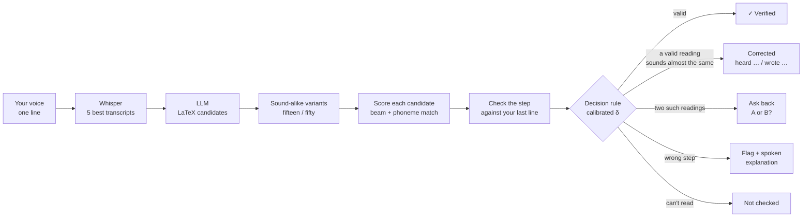

# Speech-to-LaTeX

Say a maths derivation out loud, line by line, and get it back as LaTeX with every step checked. When a step is wrong the system says so, in words and out loud. It is built for students who dictate maths (for accessibility or for learning) and for teachers who want feedback on each step.

It only corrects a line when the audio itself is ambiguous, and how often it may do that silently is calibrated to stay at about 5% (see [How it works](#how-it-works)).

Nothing is fine-tuned: the system combines off-the-shelf speech, language and symbolic-maths models.

## Contents

- [How it works](#how-it-works)
- [Results at a glance](#results-at-a-glance)
- [Running the demo](#running-the-demo)
- [Reproducing the results](#reproducing-the-results)
- [Repository layout](#repository-layout)
- [Limitations](#limitations)
- [Credits and licences](#credits-and-licences)

## How it works



Each line you say goes through six stages:

1. **Listen.** Whisper large-v3-turbo produces its 5 best transcripts of the line, not just one ([src/asr.py](src/asr.py)).
2. **Propose.** An LLM (gpt-4.1-mini) turns each transcript into up to 3 LaTeX readings ([src/candidates.py](src/candidates.py)). Every reading also gets copies with one sound-alike number swapped (13↔30 … 19↔90), because "fifteen" and "fifty" are easy to confuse ([src/augment.py](src/augment.py)).
3. **Score.** Each candidate is read aloud in words, and wav2vec2 measures how well those phonemes match your audio. The score adds Whisper's confidence in the transcript the candidate came from, the phoneme match, a small preference for the LLM's own first choice, and a bonus if SymPy can parse it ([src/rerank.py](src/rerank.py), [src/acoustic.py](src/acoustic.py)). The best-scoring candidate is "what you said".
4. **Check.** The step from your previous line to this one is checked symbolically ([src/checker.py](src/checker.py), [src/calculus.py](src/calculus.py)):
   - **Equations and inequalities:** a valid step multiplies both sides by a nonzero constant, so the ratio of the two lines' (left − right) must be constant. Inequalities must also flip exactly when that constant is negative. Otherwise the solution sets are compared, and the explanation names the slip: "subtracting 50 from both sides gives x = 40, not x = 30", "dividing by x may lose the solution x = 0", "squaring both sides can add solutions".
   - **Calculus:** derivatives are evaluated and compared; an antiderivative must differentiate back to the integrand (a missing + C is a note); a definite integral tells a wrong antiderivative apart from a wrong evaluation; `[F]_a^b` and `F|_a^b` are understood.
   - **Expressions without "=":** each line must equal the previous one (useful for `d/dx[...]` and its working).
   - **Logic:** "x = 2 and x = 3" is flagged ("did you mean or?").
   - Anything the checker cannot read stays **not checked**. It is never reported as correct.
5. **Decide** ([src/decide.py](src/decide.py)). If the best-sounding reading is valid, the line is **verified**. If it is wrong, the system looks for a valid reading whose score is within a margin δ of the best one:
   - exactly one such reading: **corrected**, shown as "heard … / wrote …";
   - two or more: **ask back** ("did you mean A or B?");
   - none: keep what you said and **flag** it with the explanation.

   δ is set by conformal calibration on held-out spoken mistakes, so that at most about 5% of genuine spoken mistakes get "fixed" silently. Sound-alike numbers, the riskiest case, get their own δ (class-conditional calibration).
6. **Explain.** Flagged lines get a comment card with the explanation, read aloud by CosyVoice2 ([src/tts_live.py](src/tts_live.py)).

The main metric for the faithfulness rule is the **silent-correction rate (SCR)**: the share of spoken mistakes whose output changed the maths without any flag. It is specific to this project. Lower is better.

## Results at a glance

All numbers are on held-out test data; full tables, sizes and caveats are in [results/reports/phase4.md](results/reports/phase4.md) and [results/results.json](results/results.json).

| What | Result |
|---|---|
| Spoken mistakes "fixed" silently, sound-alike stress test (fresh, pre-registered set, n = 100 per voice) | **2/100 and 3/100** with the calibrated rule, against 91/100 and 93/100 with no gate |
| Step checker on 200 generated test derivations (60 injected errors, 6 error types) | recall 1.00; precision 1.00 (0.857 counting flags on lines that follow an earlier error) |
| Single equations, character error rate (Speech2Latex, n = 500 / MathSpeech lectures, n = 1,101) | 0.372 / **0.324**, against 0.381 / 0.343 for plain Whisper → LLM |
| ProcessBench, 1,743 solutions where ≥ 70% of steps are algebra | precision 0.457, recall 0.087 (most of its errors are logical, which the checker cannot see) |
| Time per line on an RTX 4090 | about 2 s |

The pre-registration for the stress test is [results/reports/prereg_homophone.md](results/reports/prereg_homophone.md) (commit `8dc764e`, made before the test set existed); the result is [results/reports/confirmatory_homophone.md](results/reports/confirmatory_homophone.md).

## Running the demo

### What you need

- Linux with an NVIDIA GPU (about 9 GB of GPU memory: 5.5 GB for the app, 3.2 GB for the voice).
- Python 3.12 for the app. Python 3.10 for the optional voice (CosyVoice).
- `espeak-ng` and `ffmpeg` (`apt install espeak-ng ffmpeg`).
- An OpenAI API key (each spoken line costs a few LLM calls).

### 1. Set up the app

```bash
git clone https://github.com/csophiade/speech-to-latex.git
cd speech-to-latex
python3.12 -m venv .venv
.venv/bin/pip install -r requirements.lock.txt --extra-index-url https://download.pytorch.org/whl/cu128
echo "OPENAI_API_KEY=sk-..." > .env        # never commit this file
```

Whisper and wav2vec2 download from Hugging Face on first use.

### 2. Set up the voice (optional)

Without it, explanations are shown as text only. With it, they are also read aloud.

```bash
git clone https://github.com/FunAudioLLM/CosyVoice /workspace/models/CosyVoice
python3.10 -m venv /workspace/tts-venv
/workspace/tts-venv/bin/pip install -r /workspace/models/CosyVoice/requirements.txt
# download the CosyVoice2-0.5B weights to /workspace/models/CosyVoice2-0.5B (Hugging Face: FunAudioLLM/CosyVoice2-0.5B)
# put the LibriSpeech reference clips for the two voices in /workspace/models/tts_refs (see src/tts.py)
```

Other locations work if you set `COSYVOICE_DIR` and `COSYVOICE_MODEL`.

### 3. Start it

```bash
.venv/bin/python -W ignore demo/app.py --port 7860
```

Open <http://localhost:7860>. The app starts the voice server itself if it is installed.

- **Running on a remote GPU through VS Code?** Open the Ports panel, forward port 7860, and open `localhost:7860` in your browser. The microphone works there because the page counts as local.
- **Public link:** `demo/app.py --share --auth user:password` (or set `DEMO_AUTH=user:password`). The app refuses `--share` without a login, because the link gives access to your GPU and your API key.

### 4. Use it

1. **Say the problem**, e.g. "x squared plus five x equals fifty". Press **Record**, speak, press **Stop**; the line is checked straight away.
2. **Say each next line.** Your derivation builds up above the microphone as rendered maths, each line marked ✓ Follows, Check this step, Did you mean …?, Which did you mean?, or Couldn't read.
3. **Read or listen to the comment** on the right of a flagged line, and answer it if it asks something ("Yes, I meant fifty" / "No, keep what I said", or A / B).
4. **Typing instead?** Open **Type LaTeX instead** under the microphone; a live preview shows what you typed. Typed lines are checked the same way.
5. **Accessible view** (top of the page) enlarges text and buttons, raises contrast and reads comments aloud. Maths is rendered as MathML, so screen readers can read it.
6. **Try an example** on the right replays canned derivations line by line (no microphone needed).

Other buttons: **Remove last line**, **Start over**, **Show history**, **Show the words I said**.

## Reproducing the results

Every script is deterministic (seed 42) and caches its expensive calls (ASR, LLM, acoustic scores) under `data/cache/`, so re-runs are cheap. Every evaluation appends a row to `results/results.json`. Run from the repository root.

```bash
# data (about 2.2 GB): Speech2Latex test, MathSpeech, MathBridge few-shot pool, ProcessBench
scripts/download/download_all.sh

# Phase 1-2: single equations (Systems A-D)
.venv/bin/python scripts/run_baseline.py --system A --dataset s2l_test500
.venv/bin/python scripts/tune_cd.py --force               # tuning is frozen; --force re-runs it on en_dev only
.venv/bin/python scripts/run_ablation.py                  # A-D on en_test_500 and MathSpeech + ablation_bar.png
.venv/bin/python scripts/compare_systems.py               # paired bootstrap C vs D, clip-level differences

# Phase 3: derivations, checker, audio
.venv/bin/python -W ignore scripts/gen_derivations.py     # 400 derivations with injected errors
.venv/bin/python -W ignore scripts/eval_checker.py        # checker on the 200 test derivations
.venv/bin/python -W ignore scripts/eval_processbench.py   # ProcessBench (test only)
.venv/bin/python -W ignore scripts/synthesize_derivations.py   # needs the voice setup; then:
.venv/bin/python scripts/tts_redo.py                      # re-render clips Whisper does not hear correctly
.venv/bin/python -W ignore scripts/ingest_recordings.py --check-asr   # human recordings, if you have them

# Phase 4: decision rule, calibration, evaluation
.venv/bin/python -W ignore scripts/gen_homophone.py       # sound-alike stress set
.venv/bin/python scripts/run_derivations.py stage1        # ASR + LLM + scores for every line clip (GPU)
.venv/bin/python scripts/run_phase4.py calibrate          # δ from the calibration split only
.venv/bin/python scripts/run_phase4.py run
.venv/bin/python scripts/run_phase4.py ablation
.venv/bin/python scripts/run_phase4.py report --log       # tables, margins.json, scr_tradeoff_pooled.png

# confirmatory run (see results/reports/prereg_homophone.md)
.venv/bin/python -W ignore scripts/gen_homophone.py --fresh
.venv/bin/python -W ignore scripts/run_homfresh.py run
.venv/bin/python -W ignore scripts/run_homfresh.py report --log   # scr_tradeoff.png
```

What each dataset is for (and what it is never used for) is written in [DATASETS.md](DATASETS.md) and in a README inside each `data/` folder. The tuning (λ, γ, ε) is frozen in [results/tuned.json](results/tuned.json).

Tests: `.venv/bin/python -m pytest tests -q -W ignore` (about 5 minutes; the acoustic tests need the GPU).

## Repository layout

| Path | What is there |
|---|---|
| `src/` | the pipeline: `asr`, `candidates`, `augment`, `acoustic`, `rerank`, `checker`, `calculus`, `decide`, `calibrate`, `pipeline` (one line end to end), `eval` (metrics) |
| `demo/` | the Gradio app, its HTML rendering, canned examples and the demo script |
| `scripts/` | one script per experiment (see above) |
| `tests/` | unit and regression tests |
| `results/` | `results.json`, per-clip predictions, reports, figures, a recorded demo run |
| `data/` | datasets and caches (not in git; each folder has a README) |

## Limitations

- **The error mix is constructed.** Injected algebra slips and sound-alike swaps were generated by us. Real students make other mistakes too.
- **The guarantee assumes exchangeability.** The ≈ 5% bound on silent corrections holds when test mistakes resemble the calibration mistakes. Calibration is mostly synthetic speech; on the 6 recorded human mistakes there were no silent corrections, but that set is too small for any statistical claim.
- **Voices are not independent.** The two synthetic voices read the same derivations, so they are a sensitivity check, not two samples.
- **Checking is symbolic and partly numeric.** Equivalence is tested at random points, so it is probabilistic. It covers one-variable algebra, inequalities and basic calculus; proofs, systems of equations and word problems are not checked.
- **Mistakes cascade.** If a line is misheard and not flagged, the next correct line may be flagged against it. About half of the flags on correct lines come from this.

## Credits and licences

Models (used as released, nothing fine-tuned):

- **CosyVoice2-0.5B** (`FunAudioLLM/CosyVoice2-0.5B`), Apache-2.0: synthesises the derivation audio.
- **Whisper large-v3-turbo** (`openai/whisper-large-v3-turbo`), MIT: speech recognition.
- **wav2vec2-lv-60-espeak-cv-ft** (`facebook/wav2vec2-lv-60-espeak-cv-ft`), Apache-2.0: phoneme scores for reranking.

Voices:

- The synthetic voices v1 and v2 are cloned from LibriSpeech speakers 1272 and 1993.
  LibriSpeech ASR corpus, CC BY 4.0: V. Panayotov, G. Chen, D. Povey and S. Khudanpur, "LibriSpeech: an ASR
  corpus based on public domain audio books", ICASSP 2015. It is derived from LibriVox public-domain recordings.
  The reference clips are not redistributed.

Datasets:

- **Speech2Latex** (`marsianin500/Speech2Latex`), CC BY 4.0: main audio-to-LaTeX test set.
- **MathSpeech** (`AAAI2025/MathSpeech`): its Hugging Face card states no licence. We use it for
  evaluation only and do not redistribute it.
- **MathBridge** (`Kyudan/MathBridge`), MIT: few-shot prompt examples.
- **ProcessBench** (`Qwen/ProcessBench`), Apache-2.0: side benchmark for the step checker.

Licences were checked against the Hugging Face model and dataset cards on 2026-10-22.
